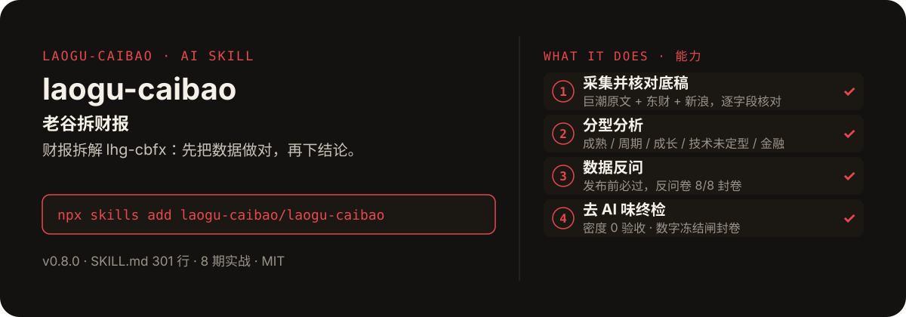

<!-- About 简介（推送后填写到仓库 About 栏）：
老谷拆财报 · 财报拆解 lhg-cbfx：先把数据做对，再下结论 ｜ 一键安装：npx skills add laogu-caibao/laogu-caibao
-->
<!-- topics（推送后打）：laogu-caibao, agent-skills, claude-code, a-share, earnings, financial-analysis, chinese -->

<p align="center">
  
</p>

> **一句话介绍**：财报拆解 skill（`lhg-cbfx`，v0.8.0）——先把数据做对，再下结论。所有数字来自本 skill 脚本生成的底稿，agent 不自己找数、不自己改阈值，保证在 WorkBuddy / Trae / Muse / ZCode 等任何 agent 上结论一致。

**一键安装**：在支持 skills 的 AI 助手里运行

```bash
npx skills add laogu-caibao/laogu-caibao
```

自更新检查：每次调用时先读本地 `SKILL.md` 的 `version`，与远端最新版比对；发现新版本先告诉用户、用户确认后才更新（`npx skills update lhg-cbfx -y`），不擅自覆盖本地定制。

## 它能帮你做什么

- **8 期财报拆解实战**（2026-10-31 至 2026-11-05，产物在 `out/`）：每期都是“采集核对 → 分析 → 反问封卷 → 成稿”的完整跑通，不是演示稿。


| 日期 | 公司 | 代码 | 报告期 | 叙事骨架 | 口播稿 |
|---|---|---|---|---|---|
| 2026-10-31 | 东山精密 | 002384 | 2026Q3 | A 业绩反差型 | — |
| 2026-10-31 | 京东方 A | 000725 | 2026Q3 | D 时间轴型 | 898 字（3 分 34 秒） |
| 2026-10-31 | 英特尔 | INTC | 2026Q3 | — | — |
| 2026-10-31 | 长鑫科技 | 688825 | 2026Q3 | C | — |
| 2026-10-31 | 长飞光纤 | 601869 | 2026Q3 | B 破案倒叙 | — |
| 2026-11-03 | 中际旭创 | 300308 | 2026Q3 | E 对账型 | 1036 字（4 分 8 秒） |
| 2026-11-03 | 新易盛 | 300502 | 2026Q3 | B 破案倒叙 | 982 字（3 分 56 秒） |
| 2026-11-05 | 华虹宏力 | 688347 | 2026Q3 | A 业绩反差型 | 1028 字（4 分 7 秒） |

（骨架与字数引自 `台账.md`；英特尔期骨架未在台账注明，故留空。叙事骨架 A–E 相邻两期不得同款，标题句式亦轮换——v0.7.5 / v0.7.8。）

- **7 份示例报告**（`examples/`，共 666 行）：贵州茅台 / 招商银行 / 万科 A 2026H1 快检报告、紫金矿业 2026Q3 快检 / 深检 / 数据核对报告、美的集团 2026H1 数据核对报告。

- **口径与阈值有出处**：`references/规则手册.md`（189 行，统一口径与阈值）、`references/底稿规范.md`（69 行，底稿 schema `cbfx.ledger/0.1`）、`references/数据源.md`（27 行，全部免费、无需登录 / Token）、`references/methods/`（3 个方法库：财务报告分析、财务报表分析、唐氏财务筛选）。

- **数字冻结闸**：分析、估值、写作里出现的每个数字，都必须能在底稿里找到对应单元格；底稿里没有的数，不许出现在报告里。改写环节只动表述，数字序列零丢失。

- **华虹宏力期的教训已写进流程**：同一控制下企业合并的追溯重述（华力微并表）曾被误报为“来源冲突”，单季差分虚高 23.31 亿；现规则是稿件一律采用原文「本报告期」披露值，禁用累计差分（SKILL.md 失败分支表第 12 条）。

- **v0.8.0 起移除出图能力**：按用户要求删 `scripts/cards.py` 与 `卡片/` 目录，四段式改三段式（标题 + 标签 / 口播稿 / 画面建议 / 附录）。

## 它是什么

`lhg-cbfx` 是 A 股公司财报拆解 skill。公司发布季报 / 年报后，用免费公开数据（巨潮原文 + 东方财富 + 新浪）采集并逐字段核对财务底稿，再按企业分型（成熟 / 周期 / 成长 / 技术未定型 / 金融）做经营实况、风险与估值位置分析。

触发词：财报拆解、季报分析、年报分析、财报快检、年报深检、看看 XX 的三季报、稿件去 AI 味。

纯 Markdown 流程 + Python 脚本取数，平台中立：WorkBuddy / Trae / Muse / ZCode 等任何能读 Markdown 指令的 agent 都能用。

## 为什么不同

- **底稿是分析层唯一的数据入口**：分析、估值、写作里出现的每个数字，都必须能在底稿里找到对应单元格；底稿里没有的数，不许出现在报告里。
- **只用本目录脚本取数和计算**：不得调用平台专属的行情 / 财务插件、MCP 或网页搜索替代底稿数据；网页信息只能作为“背景”，且必须注明来源，不得进入数字表。
- **只用 Python 3.9+ 标准库 + pdfplumber**（pymupdf 可选加速），路径一律相对本 skill 目录。
- **阈值只看规则手册，口径只看底稿规范**：同一份底稿，在任何 agent 上得出同一结论。
- **不荐股**：不给目标价、买卖建议、涨跌幅情景。
- **自包含**：方法原文在 `references/methods/`，参考库在 `libs/`（4 个：consulting、earnings-interpretation、full-link、industry），不引用外部仓库或同级目录。

## 快速上手

```bash
# 1. 安装
npx skills add laogu-caibao/laogu-caibao

# 2. 环境自检（每个新环境跑一次；有 ❌ 先修复，多为 pip install pdfplumber）
python3 scripts/doctor.py
```

### 第一次使用

```bash
# 季报快检（默认最新一期；财报当日接口未更新时自动以巨潮原文为准）
python3 scripts/collect.py 601899 --mode quick

# 年报深检（10 年年度 + 24 季 + 年报原文）
python3 scripts/collect.py 600519 --mode deep
```

然后按 `SKILL.md` 第 3 步读核对报告、先判数据能不能用，再走第 4 步分析。只想看数可以跳过第 5 步转稿与第 7 步去 AI 味终检；要发内容时，第 6 步数据反问与第 7 步是必过项。

## 流程（8 步）

1. **环境自检**：`python3 scripts/doctor.py`，Python 版本、依赖包、各免费数据源连通性。
2. **采集并核对底稿**：`scripts/collect.py`，季报快检 / 年报深检 / 指定报告期 / 用户提供的 PDF。
3. **读核对报告，先判数据能不能用**：数据不可用不硬分析。
4. **分析**：门禁 → 分型 → 结果与差异 → 驱动与持续性 → 指标 → 同源风险 → 估值位置 → 跟踪验证，全部脚本算。
5. **转稿**（要发内容时做，纯看数可跳过）：三段式口播稿（标题 + 标签 / 口播稿 / 画面建议 / 附录），骨架 A–E 轮换。
6. **数据反问**（发布前必过，默认大模型作答）：反问卷 8/8 封卷。
7. **去 AI 味终检**（要发内容时必过，纯看数可跳过）：密度 0 验收。
8. **向用户解读**。

## 目录结构

```
laogu-caibao/
├── SKILL.md  # 主流程（301 行）：8 步流程 + 失败分支表 + 目录 + 当前边界 + 自迭代协议
├── examples/  # 7 份示例报告（快检 / 深检 / 数据核对，共 666 行）
├── libs/  # 4 个参考库：consulting、earnings-interpretation、full-link、industry
├── out/  # 8 期实战产出（2026-10-31 至 2026-11-05）
├── references/  # 规则手册（189 行）/ 底稿规范（69 行）/ 数据源（27 行）/ smoke-test.md + methods/（3 个方法库）
├── scripts/  # collect.py、analyze.py、doctor.py、draft.py、pack.py、polish.py、recheck.py + cbfx/ 包
├── tests/  # 回归与探针：regress.py、backtest.py、aiwei_probe.py、recheck_probe.py 等
├── 台账.md  # 执行台账：偏离的决定当天记（缺陷与补救等价于 QC 记录）
├── assets/readme/  # README 配图（hero.svg）
└── README.md  # 本文件
```

## 自检与反馈

本仓库自带回归与探针（`tests/`）：`regress.py` 回归、`aiwei_probe.py` / `recheck_probe.py` / `reaction_probe.py` 探针；环境自检跑 `python3 scripts/doctor.py`（退出码 0 = 可用，1 = 有阻断项）。台账记录的探针结果：recheck 探针 23/23、aiwei 探针 28/28。

发现 bug 或有改进建议，以 `[QC] <一句话问题>` 为标题提交到 https://github.com/laogu-caibao/laogu-caibao/issues，正文写清“复现步骤 → 实际表现 → 期望表现”。怀疑 skill 自身缺陷（规则描述不清、检查项遗漏、探针误报）时，按 `references/smoke-test.md` 的冒烟测试标准用例执行，全绿才能排除 skill 本身问题。

## English

**laogu-caibao — Earnings teardown skill (lhg-cbfx).** For A-share companies after earnings: collect and field-check a financial ledger from free public sources (CNINFO filings, Eastmoney, Sina), then analyze operations, risks and valuation by company type (mature / cyclical / growth / pre-profit tech / financial). One rule above all: get the numbers right before concluding — every figure must trace back to a ledger cell. Install: `npx skills add laogu-caibao/laogu-caibao`.

## FAQ

**Q：laogu-caibao 有什么用？**
适合的场景：公司发了季报 / 年报，想先把财务底稿逐字段核对准，再做经营实况、风险与估值位置分析；或要把拆解转成口播稿发内容。

**Q：数据可靠吗？会荐股吗？**
数字全部来自免费公开数据（巨潮原文 + 东方财富 + 新浪），由本 skill 脚本生成底稿并逐字段核对；底稿里没有的数不许出现在报告里，取不到就标“未核验”，绝不编造。不给目标价、买卖建议、涨跌幅情景，不构成投资建议。

**Q：怎么安装？支持哪些 AI 平台？**
```bash
npx skills add laogu-caibao/laogu-caibao
```
平台中立 Markdown + Python 标准库脚本，WorkBuddy、Trae、Muse、ZCode 等环境均可用。更多 skill 见[老谷拆财报组织主页](https://github.com/laogu-caibao)。

## 出品

**老谷拆财报** —— 以数据为刃，剖市场真相

- 抖音 / 微信视频号 / 今日头条 / 快手：搜索「老谷拆财报」
- 固定栏目：「价值投资之财报解读」（全网连载中）
- 本 skill 的方法论与账号内容同源：数据驱动、拆开看、不讲黑话

> 作者声明：个人观点，仅供参考，不构成投资建议。
